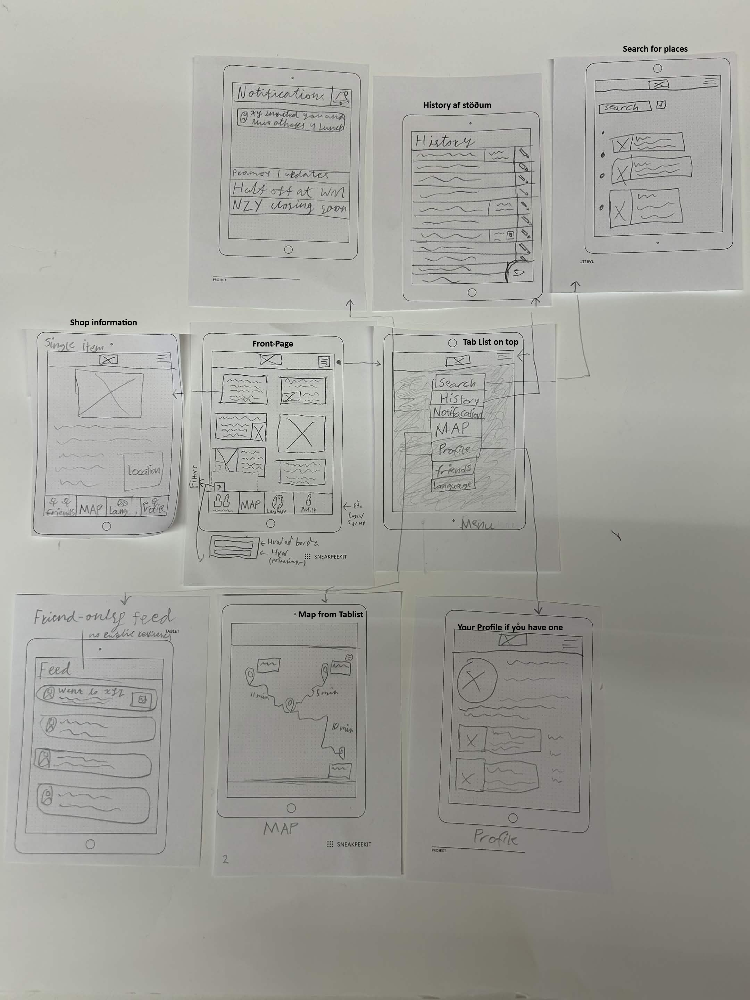

# Um appið

Appið okkar leyfir fólki að setja inn sína uppáhalds staði og láta aðra sjá hvað þeim fannst gott þarna. Það er svo hægt að sía um staði sem vinir hafa prófað og hvað þú ert ekki og ert búin að prófa. Þú getur sett inn "review" til þess að vinir þínir geta séð hvað þér fannst um staðinn eða gefið því like ef þú nennir ekki að gera "review".

# User Stories

Sem **notandi**, *langar mér* að geta **séð hvar ég hef ekki borðað** *til að* **prófa nýja staði**.

Sem **notandi**, *langar mér* að geta **séð hvað vinum mínum finnst um staði** *til að* **sjá hvað er gott** og **tengjast þeim nánar**.

Sem **notandi**, *langar mér* að geta **deilt hvar ég hef borðar** og **hvað mér finnst** *til að* **deila lífinu mínu með fólki sem mér þykir kært um**. 

# Wireflow (Clickable Image)
<a href="./images/Wireflow.png">
    </img>
</a>

 
 

# Staflar og Söfn

- Framework: [Django (Python)](https://www.djangoproject.com/)
- Frontend Library: [HTMX](https://htmx.org/)
- CSS og Styling: [tailwind](https://tailwindcss.com/)
- Gagnavinnsla: [postgreSQL](https://www.postgresql.org/)
